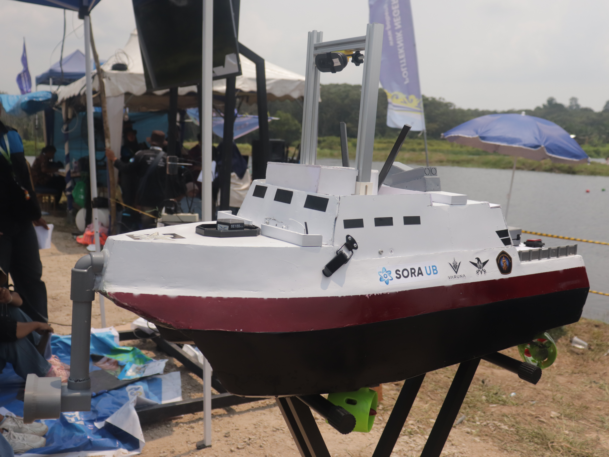
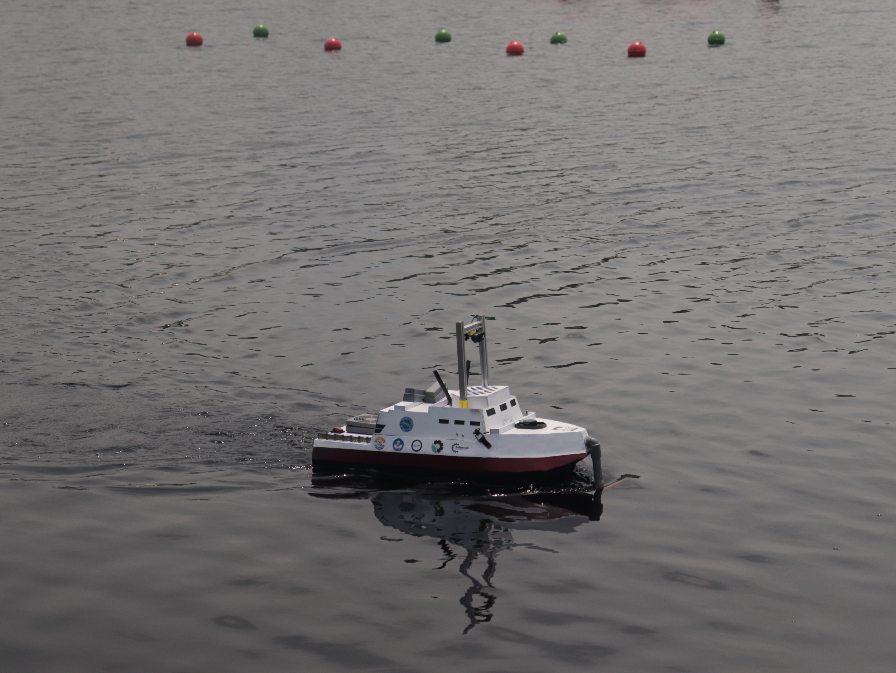
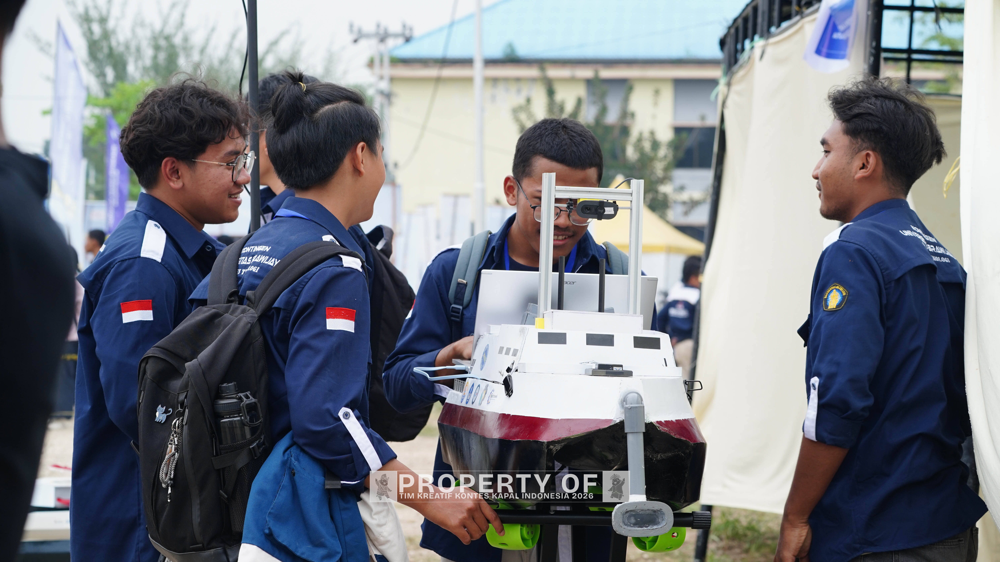
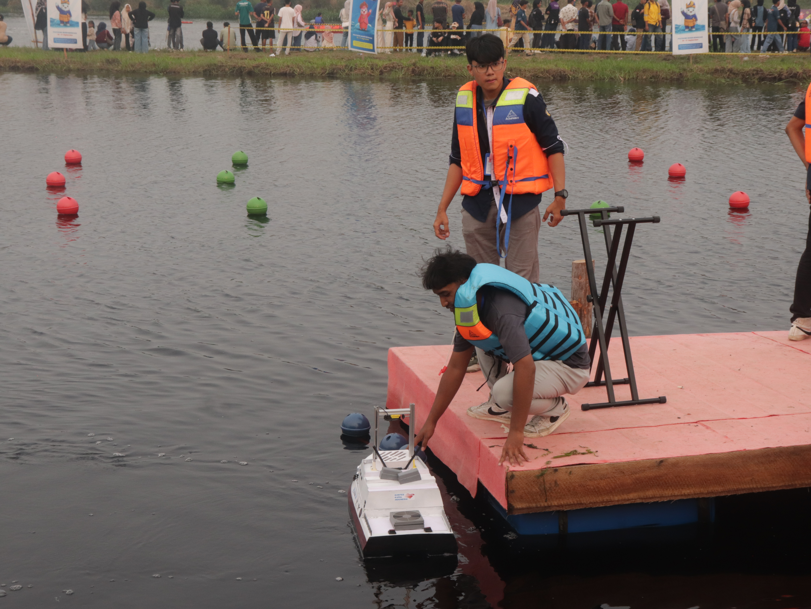
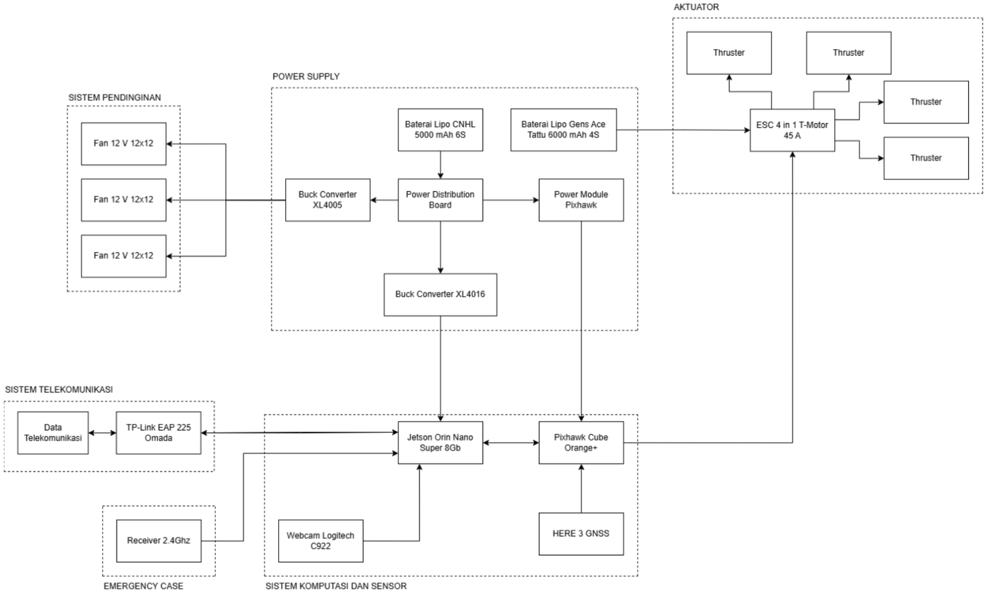
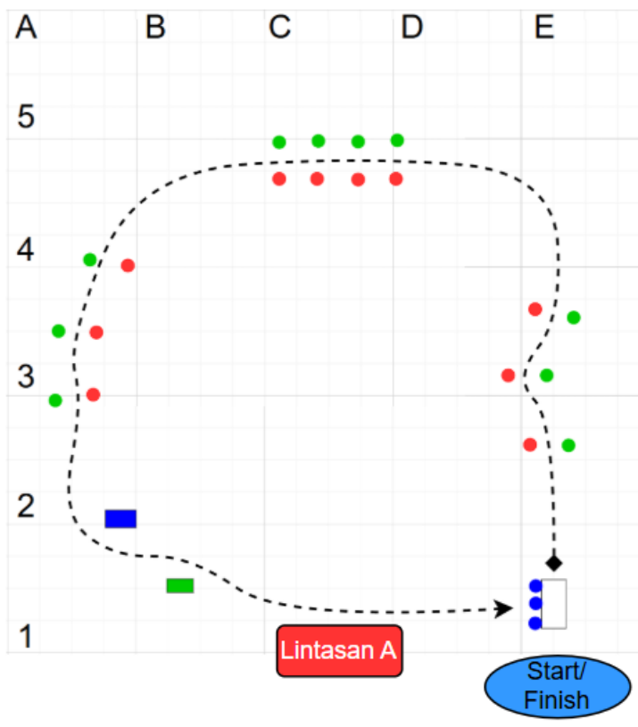
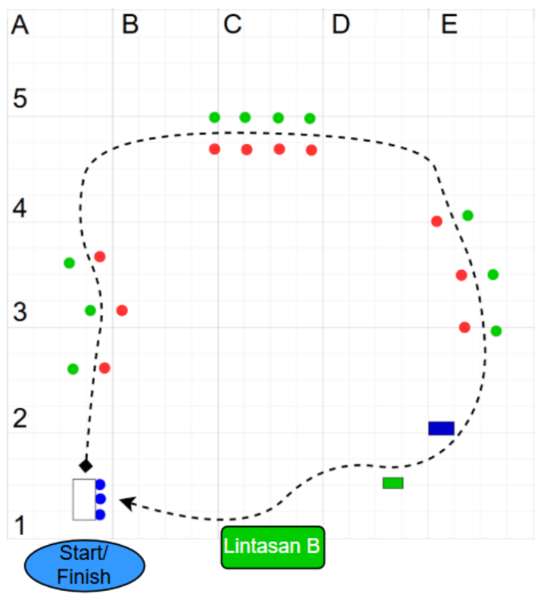
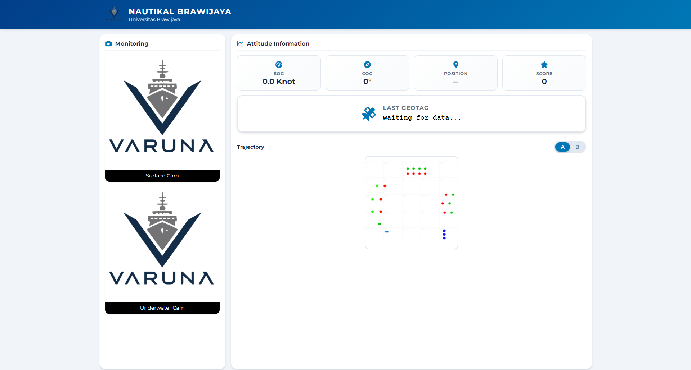

# VARUNA — Autonomous Surface Vehicle 2026

**NAUTIKAL BRAWIJAYA**

An autonomous surface vehicle developed for the Kontes Kapal Indonesia (KKI) 2026, integrating robotics, computer vision, autonomous navigation, embedded systems, and real-time monitoring.


An autonomous surface vehicle development project integrating robotics, computer vision, autonomous navigation, embedded systems, and real-time monitoring.

## 1. Project Overview

The ASV 2026 project focuses on developing an autonomous surface vehicle capable of performing mission-specific navigation and operations through an integrated robotics and computer vision system.

The system combines ROS 2-based processing, GPS waypoint navigation, computer vision, fuzzy logic control, and telemetry communication.

Developed for the **Kontes Kapal Indonesia (KKI) 2026**, the project integrates onboard computing, flight controller systems, sensors, propulsion, and a web-based monitoring interface.

## 2. Project Gallery

### Autonomous Surface Vehicle





### Competition and Field Testing





## 3. Core Technologies

| Category | Technologies |
|---|---|
| Robotics Middleware | ROS 2 |
| Programming | Python |
| Computer Vision | OpenCV, YOLO |
| Deep Learning | PyTorch |
| AI Acceleration | CUDA, TensorRT |
| Navigation | GPS Waypoint Navigation |
| Autonomous Control | Fuzzy Logic |
| Flight Controller Interface | MAVROS |
| Data Communication | Python Upload Node |
| Cloud Database | Supabase |
| Monitoring | Web-based Dashboard |

## 4. Hardware Architecture

The onboard hardware integrates computing, navigation, sensing, power distribution, communication, and propulsion systems.

### Electrical System Diagram



### Main Hardware Components

- Jetson Orin Nano Super 8GB
- Pixhawk Cube Orange+
- HERE 3 GNSS
- Logitech C922 Webcam
- T-Motor 4-in-1 ESC 45A
- Four propulsion thrusters
- TP-Link EAP225 Omada
- LiPo battery systems
- Power distribution and voltage regulation modules

For further details, see [Hardware and Software Integration](docs/hardware-software-integration.md).

## 5. Software Architecture

The software architecture integrates ROS 2, computer vision, autonomous navigation, and telemetry processing.

Main system components:

- Computer Vision: Visual perception and image processing using OpenCV and YOLO.
- Navigation and Control: GPS-based waypoint navigation and fuzzy logic control.
- Autopilot Integration: Communication between ROS 2 and Pixhawk through MAVROS.
- Data Communication: Telemetry and processed data transmission through a Python upload node.
- Cloud Integration: Supabase database integration for remote monitoring.

### Data Communication Flow

ROS 2 processes telemetry and system data onboard. A dedicated Python upload node transfers telemetry and processing results to Supabase, allowing the web dashboard to retrieve and visualize monitoring information.

For a detailed explanation, see [System Architecture](docs/architecture.md).

## 6. Mission Configurations

The ASV supports two mission configurations designed for different competition routes.

### Mission A



### Mission B



Each mission uses different navigation configurations and node combinations according to the corresponding competition route.

See [Mission and Navigation Documentation](docs/mission-navigation.md).

## 7. ASV Monitoring Dashboard

The web-based monitoring dashboard provides an interface for observing vessel information, camera feeds, navigation data, and mission progress.



### Dashboard Features

- Surface camera monitoring
- Underwater camera monitoring
- Speed Over Ground (SOG)
- Course Over Ground (COG)
- GPS position and geotag information
- Vessel trajectory visualization
- Mission A and Mission B interfaces

See [Project Gallery](docs/project-gallery.md).

## 8. Technical Documentation

| Documentation | Description |
|---|---|
| [System Architecture](docs/architecture.md) | Overall system architecture |
| [Mission Navigation](docs/mission-navigation.md) | Mission A and B navigation |
| [Hardware and Software Integration](docs/hardware-software-integration.md) | Hardware and software integration |
| [Competition](docs/competition.md) | KKI 2026 competition documentation |
| [Project Gallery](docs/project-gallery.md) | Project images and visual documentation |

## 9. Repository Structure

```text
ASV-Autonomous-System2026/
│
├── ASV-Autonomous-System2026/
│   ├── Launch/
│   └── Node/
│
├── docs/
│   ├── architecture.md
│   ├── competition.md
│   ├── dashboard.png
│   ├── mission-navigation.md
│   ├── mission-tracks-A.png
│   ├── mission-tracks-B.png
│   ├── project-gallery.md
│   └── sistem-elektrik.png
│
└── README.md
```

## Project Identity

| Information | Details |
|---|---|
| Vessel Name | VARUNA |
| Team | NAUTIKAL BRAWIJAYA |
| Competition | Kontes Kapal Indonesia (KKI) 2026 |
| System | Autonomous Surface Vehicle |


## 10. Development Status

This repository contains selected source code and technical documentation from the ASV 2026 development project.

The repository is intended to document the system architecture, software implementation, hardware integration, and competition development process.

Additional configuration, hardware dependencies, and environment setup may be required to reproduce the complete system.
