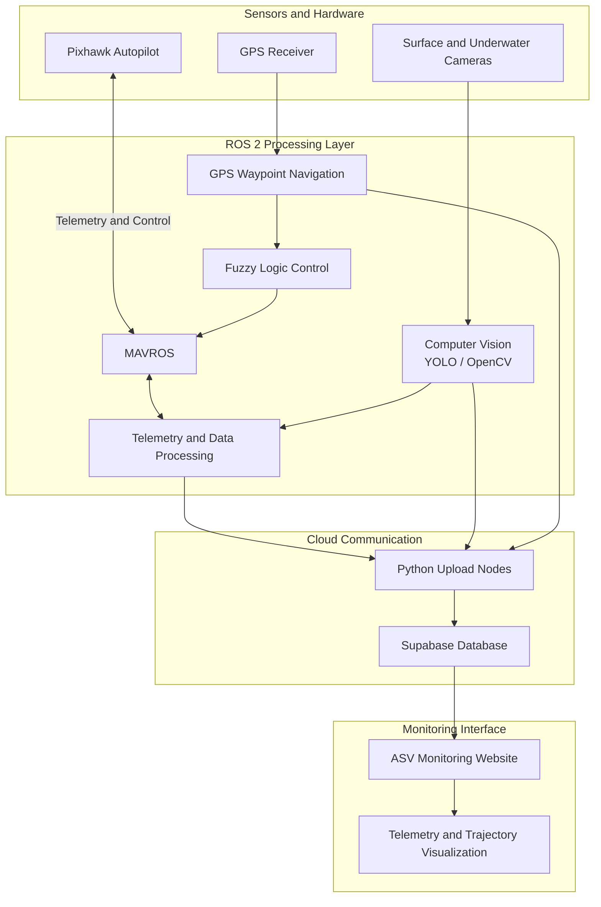

# ASV 2026 — System Architecture

## 1. Overview

The Autonomous Surface Vehicle (ASV) 2026 is a
ROS 2-based autonomous vessel integrating robotics,
computer vision, GPS navigation, and embedded control.

The system combines autonomous perception, waypoint
navigation, fuzzy logic control, and telemetry
communication to support autonomous vessel operations.

## 2. System Architecture

## 3. Main System Components

### A. Computer Vision
- Camera-based visual perception.
- YOLO-based object detection.
- OpenCV image processing.

### B. Navigation and Control
- GPS-based waypoint navigation.
- Mission A and Mission B configurations.
- Fuzzy Logic-based control.

### C. Autopilot Integration
- Pixhawk flight controller.
- ROS 2 and MAVROS communication.
- Vessel telemetry and control commands.

### D. Data Communication
- Python-based ROS 2 upload nodes.
- Telemetry and processed data transmission.
- Supabase cloud database integration.

### E. Monitoring Website
- Surface camera monitoring interface.
- Underwater camera monitoring interface.
- SOG and COG visualization.
- GPS position and geotag information.
- Vessel trajectory visualization.
- Mission A and Mission B interfaces.

## 4. Data Flow

1. Sensors and hardware provide camera and navigation data.
2. ROS 2 processes sensor information and coordinates
   autonomous perception and navigation.
3. Computer vision and navigation modules generate
   processed information.
4. Fuzzy Logic generates control decisions.
5. MAVROS communicates with Pixhawk for telemetry
   exchange and vessel control.
6. Python upload nodes transmit telemetry and processed
   data from ROS 2 to Supabase.
7. The monitoring website presents available vessel
   information and visualizations.

## 5. Project Status

The source code and monitoring website interface are
available for review.

Live backend connectivity and real-time data monitoring
are currently offline.
